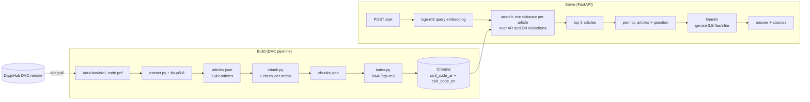

# Arabic Legal RAG: Egyptian Civil Code Q&A

Question answering over the bilingual (Arabic/English) Egyptian Civil Code (Law 131 of 1948), 1,149 articles.
A question is embedded, the nearest articles are retrieved, and Gemini answers **only from those articles**,
citing article numbers.

> **Informational only. Not legal advice.** The answer model can be wrong, and the retrieval step can miss
> the relevant article (see [Known limits](#honesty-known-limits)).

## Architecture



## Quick start (3 commands)

You need a Gemini API key in `.env` (`GEMINI_API_KEY=...`, no quotes), see `.env.example`.

```bash
uv sync
uv run dvc pull                      # needs a free DagsHub account, see "Data" below
uv run uvicorn arabic_legal_rag.api:app --port 8000
```

With Docker (the image already contains the index):

```bash
docker compose up --build     # reads .env; host port can be changed with HOST_PORT=8001
```

```bash
curl http://localhost:8000/health
# {"status":"healthy","documents_indexed":1149}

curl -X POST http://localhost:8000/ask -H "Content-Type: application/json" \
     -d '{"question": "ما هي شروط استحقاق التعويض عن التأخير؟"}'
```

An empty question returns HTTP 422.

The default model is `gemini-3.5-flash-lite`. To use another one, set `GEMINI_MODEL` in the shell environment,
not in `.env` (`rag.py` reads it before `.env` is loaded).

### What `sources` means

`sources` lists **every article that was retrieved and given to the model** (the top 8, as `Egyptian Civil Code, Article N`),
not only the ones the answer actually cites. Read the answer text to see which article numbers it relied on.

## Data and reproducibility (DVC)

The raw PDF, processed corpus and vector index are stored on DagsHub
(`https://dagshub.com/radwakandeel/arabic-legal-rag`). Reading them requires a **free DagsHub account and an
access token** (user menu > Settings > Tokens). Anonymous access is rejected.

```bash
uv run dvc remote modify origin --local auth basic
uv run dvc remote modify origin --local user <your-dagshub-username>
uv run dvc remote modify origin --local password <your-token>
uv run dvc pull
```

The credentials stay in `.dvc/config.local`, which git ignores. Without credentials, `dvc pull` may report the
cache files as missing and then fail on `civil_code.pdf`. That message means authentication failed, not that the
file is missing.

Pipeline (`dvc.yaml`): `corpus` (PDF to `articles.json`), `chunks`, `index` (Chroma with `BAAI/bge-m3`).
`uv run dvc repro` rebuilds it. What was and was not verified:

- Rebuilding `articles.json` from the PDF gives a file **byte-identical** to the committed one.
- The `index` stage was **not verified end to end through `dvc repro`**. The first run was killed (exit 137,
  most likely out of memory on a machine with about 3.7 GB RAM). `index.py` now embeds and adds in batches
  of 64, but that version was never run to completion.
- The index recorded in `dvc.lock` was **restored from cached bge-m3 embeddings** (same model, same text),
  not produced by a full `dvc repro`. Retrieval metrics on it matched the original index exactly.
- `pyproject.toml` and `uv.lock` are deliberately not DVC dependencies, so adding a library does not force
  a 20-minute index rebuild. The cost: a dependency change does not invalidate the pipeline by itself.

## Retrieval evaluation

Question set: `eval/questions_50.json`, 45 retrieval questions (33 dev, 12 test, fixed split) and 5
hallucination questions. The gold articles were chosen by reading the article text, not from memory.
The test split was measured **once** and never used for choices.

| Embedding model | dev hit@1 | dev hit@10 | dev MRR | test hit@1 | test hit@10 | test MRR |
|---|---|---|---|---|---|---|
| multilingual-e5-small | 0.281 | 0.625 | 0.437 | 0.333 | 0.750 | 0.505 |
| **BAAI/bge-m3** (chosen) | 0.469 | 0.750 | 0.541 | 0.583 | 0.833 | 0.665 |

(dev = 32 questions in this comparison; on the final index, 33 dev questions: hit@1 0.485, MRR 0.555.)

bge-m3 was chosen because it has the higher MRR on dev. Chunk size (400 vs 1500) and reciprocal-rank fusion
made no measurable difference, because articles are short. All 11 early runs and 6 final runs are in MLflow
(experiments `arabic-legal-rag-retrieval` and `arabic-legal-rag-retrieval-v2`). The Model Registry holds a
**configuration** (bge-m3, minimum distance, chunk 1500) as `arabic-legal-rag-retrieval-config` v1 with alias
`production`, not a trained model. Screenshots and the run table are in `reports/`.
The RAGAS scores (`ragas_faithfulness`, `ragas_answer_relevancy`, `ragas_context_precision`,
`ragas_context_recall`, plus a `_missing` count each) are logged on the `register-best-config` run that the
alias points to (`reports/mlflow_registry_ragas.png`, logged by `scripts/log_ragas_to_mlflow.py`). They come
from a separate evaluation, not from the retrieval run, see [RAGAS](#ragas). `mlflow.db` is not in git, so
that screenshot is the record.

## Answer quality

### Hallucination check (5 questions, temperature 0)

Small and manual: five questions, read by one person who is not a lawyer. "Not found" means not found in the
8 retrieved articles, not in the whole code.

- An earlier pass with `gemini-3.8-flash`: three questions were clean refusals, one answered the damages
  conditions in line with the articles (plus one generalising sentence), one ambiguous question stayed grey.
- `gemini-3.5-flash-lite` (default): no invented article numbers (every number it cited was in `sources`).
  One question answered "not found" although the retrieved articles contained the relevant formalities, and the
  ambiguous question was answered from article 1 instead of asking for clarification. One answer ended with a
  stray English sentence.

### RAGAS

Run once with `scripts/run_ragas.py` (20 retrieval questions from the dev split, 8 retrieved articles per
question, judge = `gemini-3.5-flash-lite`). Raw summary: `reports/ragas_summary.json`.

| Metric | Mean | Questions scored |
|---|---|---|
| Faithfulness | **0.824** | 20 / 20 |
| Answer relevancy | 0.673 | 19 / 20 (one judge reply could not be parsed) |
| Context precision | 0.417 | 20 / 20 |
| Context recall | 0.608 | 20 / 20 |

How to read these numbers:

- **Fewer questions than the handbook asks for.** 20, not 50, because the free Gemini tier limits requests per
  day (about 14 to 19 requests per question for four metrics).
- **Abstentions count as zero.** Two of the 20 answers were "not found in the retrieved articles" (the retrieval
  missed the right articles). RAGAS scored them 0 for both faithfulness and answer relevancy, so an honest
  refusal lowers the mean. Faithfulness over the other 18 questions is about 0.915. That second figure was
  computed **after** seeing the results, so treat it as an analysis, not the headline number.
- **One unexplained zero.** Question `n17` got an answer that cites article 120, which was retrieved, yet
  faithfulness 0.0. We did not check whether the judge or the answer is at fault.
- **Context precision looks unreliable here.** Several questions have recall 1.0 and precision 0.0 together
  (`h09`, `n02`), which is odd: the retrieved text covers the reference but the judge calls none of it useful.
  Do not read the 0.417 as a precise number.
- The judge is the **same model that wrote the answers**, which can bias scores upward.
- `reference` is the **text of the gold articles** (no hand-written reference answers), so recall measures how
  much of the gold article text the retrieved context covers.
- A faithfulness gate runs in CI (see [CI/CD](#cicd)) and fails below 0.75. The planned alert level of 0.80 is
  not implemented yet, and the measured 0.824 is only 0.024 above it.

## CI/CD

GitHub Actions (`.github/workflows/ci.yml`), on pushes and pull requests:

- `test` job: `uv sync --frozen`, ruff (`src` and `tests`), `dvc pull` from DagsHub (secrets `DAGSHUB_USER`,
  `DAGSHUB_TOKEN`), pytest.
- `docker` job: `dvc pull`, build the image (the index is baked in), and push it to the GitHub Container
  Registry on `main` only.

CI runs `dvc pull` instead of rebuilding the index, so it does **not** prove the index can be rebuilt from scratch.
A second workflow, `.github/workflows/faithfulness-gate.yml`, is the **faithfulness gate**. It generates answers for
20 dev questions, scores faithfulness with RAGAS, and **fails the run if the mean is below 0.75**
(`scripts/run_ragas.py --n 20 --metrics faithfulness --fail-below 0.75`, about 60 Gemini requests and 9 minutes).
It needs the `GEMINI_API_KEY` secret. To save the free-tier quota it only runs when `src/`, `dvc.lock`, `eval/`
or the script change, or by hand from the Actions tab. The first run passed (the score is in that run's job summary).

Limits of the gate:

- Answers are regenerated on every run, so the score moves a little between runs. The margin over the threshold
  is small (0.824 measured locally against 0.75).
- An honest "not found in the retrieved articles" answer counts as faithfulness 0 in RAGAS, so a retrieval
  regression can fail the gate even when the model does not hallucinate.
- It runs after code is pushed to `main` and on pull requests; it does not by itself block a merge unless branch
  protection requires it (not enabled).

## Honesty: known limits

- **Retrieval misses.** Search always returns the nearest 8 articles, even for a meaningless question; there
  is no relevance threshold. The model is the only thing that says "not found". About a quarter of the dev
  questions do not have the right article in the top 10 even with bge-m3. Article 163 ranks 11th or lower when
  the question wording differs from the article text.
- **Small, non-expert evaluation.** The test split has 12 questions (one question = 8 points). Gold articles
  were checked by reading the text, not by a lawyer. Treat the metrics as a signal, not a verdict. Five
  questions marked `weak` have a gold article that is inferred, not stated.
- **Metric implementation.** MLflow numbers are computed with numpy, `eval_hard` through Chroma; a one-question
  difference can appear between them.
- **Source PDF defects.** The corpus is extracted from a bilingual PDF and corrected by `scripts/fixup5-8.py`.
  Known remaining problems: chapter headings are glued to the end of articles 388 and 552, and some words are
  glued together in the text (for example `أنيتبينه`, `وقعالضرر`). Articles
  84, 499, 970, 1085 and 865 and one odd phrase ("ما لم اتفاق يخالف ذلك") have **not yet been checked** against the PDF.
  56 articles are repealed; they stay in the index and are flagged `[REPEALED]` in the prompt.
- **Needs the internet and a large model.** Answers need the Gemini API. The embedding model (bge-m3) is about
  2 GB. Arabic text is not normalized beyond what the extraction does.
- **Not implemented yet:** serving with BentoML, a Locust load test and
  canary notes, Grafana dashboards with the faithfulness alert, a streaming `/ask`, a batch re-indexing script,
  and Arabic text normalization for search.

## Repository layout

```
src/arabic_legal_rag/   extract, chunk, index, rag, api, eval_retrieval, eval_hard, experiment
scripts/                corpus fix-ups (fixup5-8), run_ragas.py
eval/                   questions_50.json
reports/                MLflow screenshots, runs csv, RAGAS summary
tests/                  pytest (9 tests)
dvc.yaml, dvc.lock      pipeline and its recorded outputs
Dockerfile, docker-compose.yml, .github/workflows/
```
